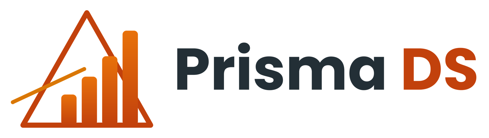
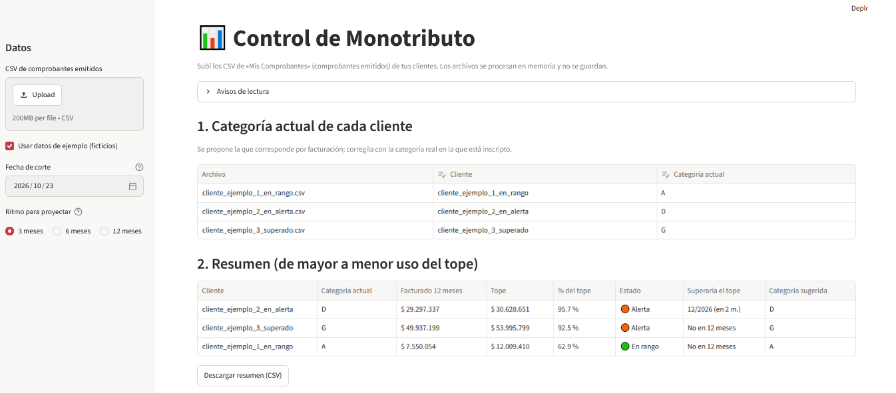
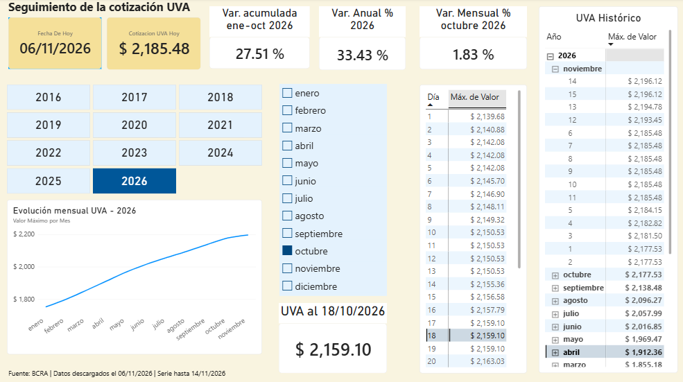
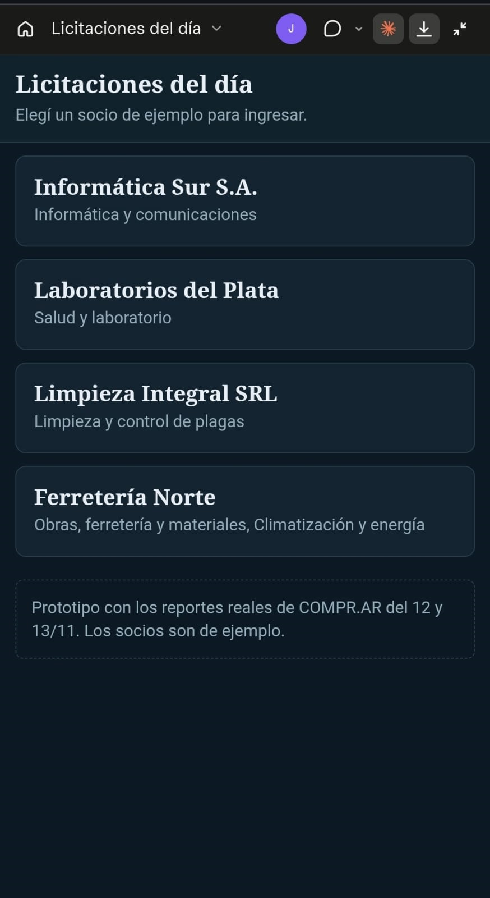
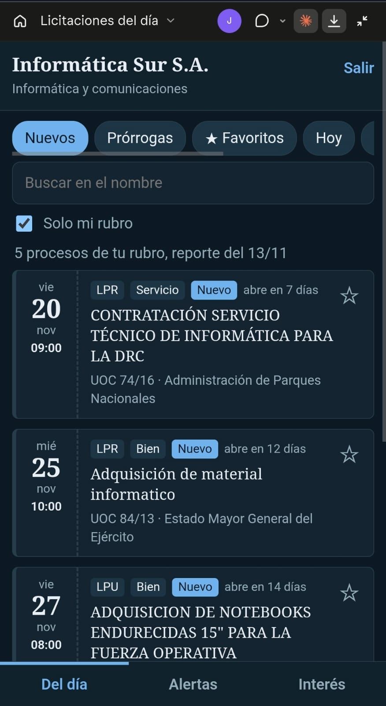
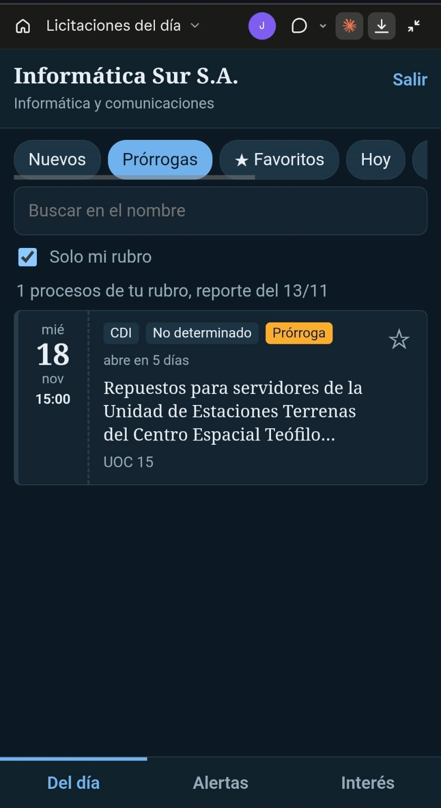
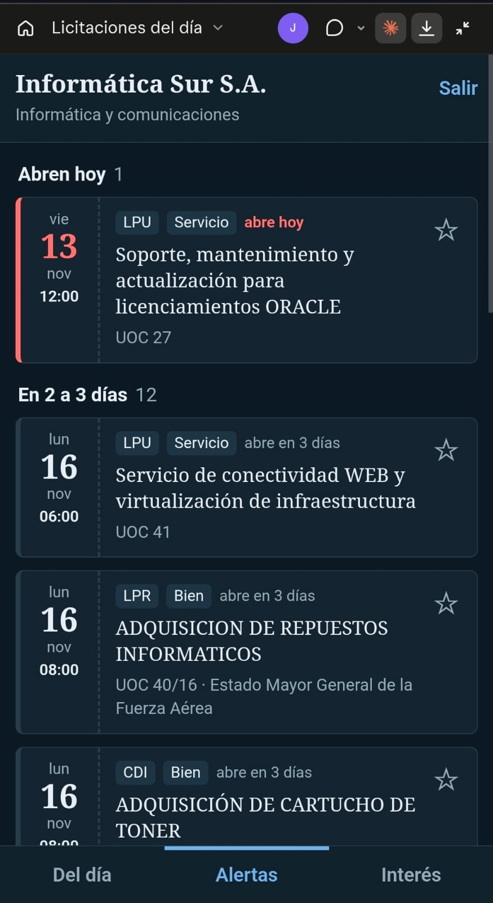
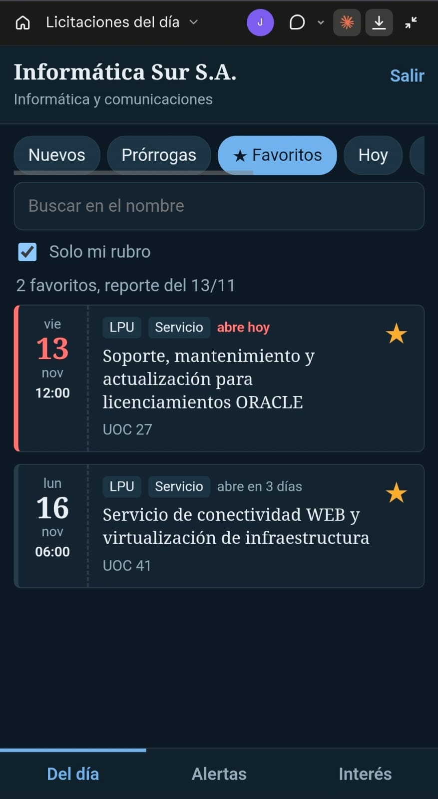
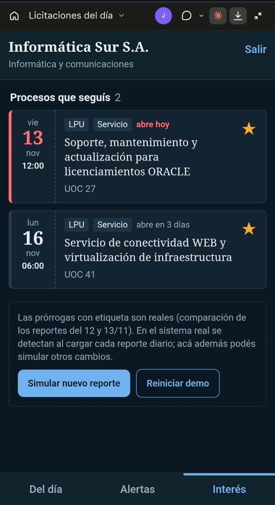

  <picture>
    <source media="(prefers-color-scheme: dark)" srcset="images/fondo-oscuro.png">
    
  </picture>

  <b>Consultoría de datos</b> · Power BI · SQL · Python 
  <a href="https://prismads.com.ar">prismads.com.ar</a> ·
  <a href="https://www.linkedin.com/company/prismads">LinkedIn</a> ·
  <a href="mailto:TU-EMAIL@prismads.com.ar">Contacto</a>

# Quiénes somos

En Prisma DS ayudamos a las empresas a tomar decisiones con información clara y confiable.

Somos una consultoría de datos especializada en reportes, modelado y automatización con Power BI, apoyada en bases de datos SQL (PostgreSQL, SQL Server, Oracle) y Python.

# Qué hacemos

- Dashboards e informes en Power BI a medida
- Integración y organización de datos desde bases de datos, Excel y otras fuentes
- Automatización de reportes y pipelines de datos
- Capacitación para equipos que quieren usar sus propios reportes

# Proyectos

> Los proyectos de esta vitrina trabajan con datos públicos o de ejemplo. No se publica información de clientes.

| Proyecto | Qué resuelve | Tecnologías | Repositorio |
|---|---|---|---|
| **Informe de gestión de ventas** | Consolida años de ventas en un tablero ejecutivo | Python, Power BI, DAX | [Ver código](https://github.com/Prisma-DS/informe-gestion-PDS) |
| **Control de Monotributo** | Controla el tope de facturación de múltiples clientes | Python, Pandas, Streamlit, Plotly | [Demo](https://prismads-monotributo-demo.streamlit.app) · [Código](https://github.com/Prisma-DS/tablero-monotributo-streamlit) |
| **Seguimiento de Cotización UVA** | Consulta y variaciones de la UVA con datos del BCRA | Power Query, Power BI, DAX | [Ver](https://github.com/Prisma-DS/tablero-uva-powerbi) |
| **Licitaciones del Día** | Filtra y avisa sobre compras públicas por rubro | Python, PostgreSQL, Streamlit | [Ver](https://github.com/Prisma-DS/alertas-contrataciones-publicas) |

## 📊 Informe de gestión de ventas (Power BI)

> Proyecto de demostración construido sobre **datos de ejemplo**; no corresponde a un cliente real.

### El desafío de negocio
Las empresas con múltiples puntos de venta suelen acumular años de registros históricos en archivos sueltos (CSV/Excel) sin poder cruzarlos. Esto dificulta detectar qué sucursales son realmente rentables, qué productos inmovilizan capital y cómo evolucionan los hábitos de pago de los clientes.

### La solución de Prisma DS
Diseñamos un flujo de análisis completo, desde la limpieza de los datos hasta un tablero ejecutivo interactivo, que consolida diez años de registros de ventas de ejemplo para que la gerencia pueda consultarlos de forma ágil y decidir con evidencia.

### Hallazgos del análisis (sobre datos de ejemplo)

- **Concentración de riesgo:** en los datos de ejemplo, una sola sucursal concentra el 44,45% de la facturación total. El tablero permite detectar este tipo de dependencia y diseñar estrategias para equilibrar el resto de las sedes.
- **Inventario:** el tablero aísla los productos de baja rotación, para evaluar su discontinuación y liberar capital de trabajo.
- **Estrategia financiera:** el análisis de medios de pago muestra el peso de cada canal e ilustra la necesidad de impulsar los electrónicos para agilizar el flujo de caja.

### Arquitectura y stack tecnológico

- **ETL y análisis exploratorio:** Python (Pandas, Matplotlib, Seaborn) para la limpieza, unificación y validación de registros históricos.
- **Modelado y optimización:** Power BI y DAX Studio para la creación de métricas de negocio complejas y tiempos de respuesta rápidos.

🔗 **[Explorar el repositorio y el código](https://github.com/Prisma-DS/informe-gestion-PDS)**

## 🧾 Control de Monotributo: proyección y automatización para estudios contables

### El desafío de negocio
Los estudios contables suelen gestionar decenas o cientos de clientes monotributistas revisando manualmente planillas descargadas de ARCA. Este proceso consume horas administrativas y expone a los clientes a recategorizaciones de oficio o exclusiones del régimen por superar los topes de facturación.

### La solución de Prisma DS
Desarrollamos una aplicación web interactiva que automatiza el control de facturación de múltiples clientes en segundos. Procesa los archivos CSV de *Mis Comprobantes* (ARCA), aplica los topes por categoría y proyecta el ritmo de facturación de cada contribuyente para anticiparse a los vencimientos.

> **Nota:** es una herramienta de apoyo. Los topes de cada categoría deben mantenerse actualizados y no reemplaza la verificación del profesional contable.

### Funcionalidades clave
* **Ahorro de tiempo operativo:** procesamiento masivo y simultáneo de comprobantes (restando notas de crédito y excluyendo recibos automáticamente). Los archivos cargados no se guardan en el servidor.
* **Alertas tempranas con semáforo:** clasificación automática de clientes según el porcentaje de consumo de su tope anual (*En rango, Atención, Alerta, Superado*).
* **Proyección a 12 meses:** cálculo de ventana móvil que estima en qué mes el cliente superaría su categoría actual según su ritmo de facturación reciente (3, 6 o 12 meses) y cuánto tiene disponible para facturar sin pasarse.
* **Reportes listos para gestión:** sugerencia de categoría correspondiente y exportación inmediata del resumen ejecutivo a CSV.

### Arquitectura y stack tecnológico
* **Procesamiento y lógica de negocio:** Python y Pandas con arquitectura modular, separada de la interfaz y cubierta con pruebas automatizadas (`pytest`).
* **Interfaz y visualización:** Streamlit y Plotly, sin necesidad de instalación local para el usuario final.

🚀 **[Probar la demo (datos de ejemplo)](https://prismads-monotributo-demo.streamlit.app)**

🔗 **[Explorar el repositorio y el código](https://github.com/Prisma-DS/tablero-monotributo-streamlit)**

## 📈 Seguimiento de Cotización UVA: datos oficiales del BCRA

### El desafío de negocio
En el mercado argentino, contratos comerciales, alquileres, presupuestos de construcción y créditos se ajustan por Unidad de Valor Adquisitivo (UVA). Consultar manualmente las series históricas del Banco Central o calcular variaciones interanuales y acumuladas en hojas de cálculo genera demoras y errores al actualizar valores o proyectar costos.

### La solución de Prisma DS
Diseñamos un tablero financiero interactivo conectado a los registros oficiales del Banco Central de la República Argentina (BCRA). Permite consultar la evolución histórica desde 2016 hasta la actualidad y automatiza el cálculo de los indicadores clave.

### Funcionalidades clave
* **Consulta histórica instantánea:** navegación por año, mes y día exacto para liquidaciones o actualizaciones contractuales, sin búsquedas manuales.
* **Análisis de variaciones automatizado:** cálculo dinámico de variación mensual, interanual y acumulada mediante inteligencia de tiempo, para evaluar el impacto de la inflación en costos o ingresos.
* **Experiencia intuitiva:** títulos dinámicos que se adaptan a los filtros seleccionados, lo que facilita la lectura ejecutiva y la exportación de reportes.

### Arquitectura y stack tecnológico
* **Extracción y transformación (ETL):** Power Query para la limpieza, estructuración y actualización de las series oficiales del BCRA.
* **Modelado y analítica:** Power BI y DAX avanzado (tabla calendario dedicada y medidas de inteligencia de tiempo).

🔗 **[Explorar el repositorio](https://github.com/Prisma-DS/tablero-uva-powerbi)**

## 📱 Licitaciones del Día: alertas automatizadas de compras públicas

### El desafío de negocio
Las empresas proveedoras del Estado y los socios de cámaras empresarias suelen recibir listados masivos y sin filtrar de las contrataciones públicas (como las del portal COMPR.AR). Revisar cientos de registros diarios de forma manual consume horas, hace que se pierdan oportunidades por falta de tiempo y expone a los equipos comerciales a no enterarse si una licitación de su interés sufrió una prórroga o un cambio de fecha.

### La solución de Prisma DS
Diseñamos un sistema de ingesta, clasificación y notificación móvil. La plataforma procesa diariamente los procesos de compra pública, los categoriza por rubro y tipo (bien o servicio) y envía alertas personalizadas al celular de cada empresa solo sobre las licitaciones relevantes para su negocio.

> **Sobre los datos:** la información proviene del portal público COMPR.AR. Prisma DS no tiene vinculación con el organismo. Las pantallas muestran socios de ejemplo.

<table>
  <tr>
    <td align="center"> Ingreso con socios de ejemplo</td>
    <td align="center"> Nuevos del rubro</td>
    <td align="center"> Prórrogas con el detalle del cambio</td>
  </tr>
  <tr>
    <td align="center"> Alertas de aperturas próximas</td>
    <td align="center"> Favoritos</td>
    <td align="center"> Cambios en los procesos seguidos</td>
  </tr>
</table>

### Funcionalidades clave
* **Filtrado automático por rubro:** cada empresa ve solo las oportunidades alineadas a su actividad, sin revisar planillas interminables.
* **Alertas de vencimiento y prórrogas:** monitoreo continuo de estados para avisar qué licitaciones están próximas a abrir y notificar si un proceso guardado como favorito cambia de fecha.
* **Consultas en lenguaje natural (opcional):** integración con modelos de lenguaje que permite buscar oportunidades en castellano cotidiano. Al usarla, la consulta del usuario se envía vía API al proveedor del modelo.
* **Arquitectura escalable:** pensada tanto para empresas individuales como para cámaras empresarias que quieran ofrecer un servicio de valor agregado a sus socios.

### Arquitectura y stack tecnológico
* **Ingeniería de datos y backend:** Python, Pandas, PostgreSQL y SQLAlchemy para la extracción, limpieza, clasificación automatizada y almacenamiento estructurado de procesos.
* **Analítica y prototipo móvil:** HTML, JavaScript, Streamlit y Altair para la visualización y una experiencia mobile-first.
* **Inteligencia artificial:** integración vía API de procesamiento de lenguaje natural para búsquedas conversacionales.

🔗 **[Explorar el repositorio](https://github.com/Prisma-DS/alertas-contrataciones-publicas)**

# Trabajemos juntos

¿Tenés reportes que te llevan demasiado tiempo o datos dispersos en varios archivos? Contanos tu caso: la primera consulta es sin cargo.

📧 [contacto@prismads.com.ar](mailto:contacto@prismads.com.ar) · 🌐 [prismads.com.ar](https://prismads.com.ar) · 💼 [LinkedIn](https://www.linkedin.com/company/prismads)
