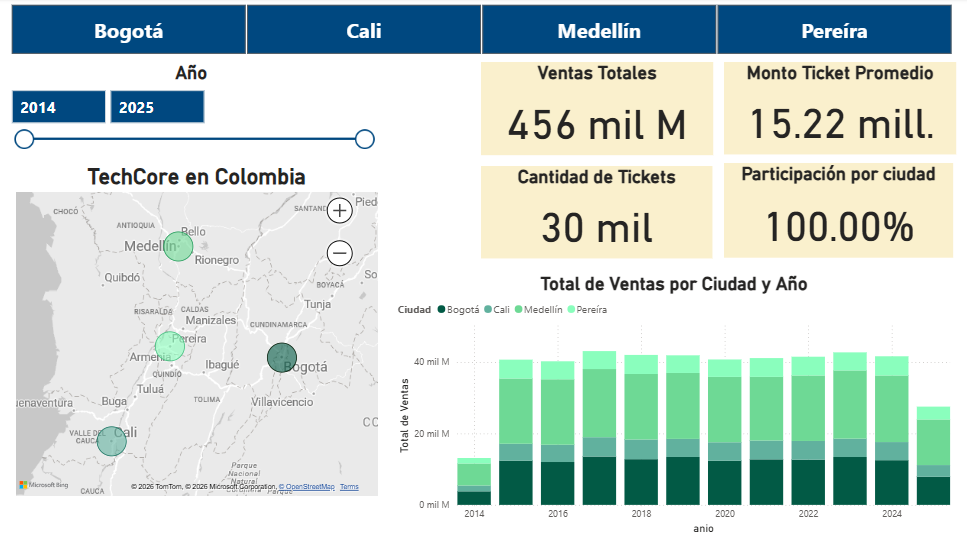

# Quienes Somos
En Prisma DS ayudamos a las empresas a tomar decisiones con información clara y confiable. 

Somos una consultoría de datos especializada en reportes, modelado y automatización con Power BI, apoyada en bases de datos SQL (PostgreSQL, SQLServer, Oracle) y Python.

# Qué hacemos
- Dashboards e informes en Power BI a medida
- Integración y organización de datos desde bases de datos, Excel y otras fuentes
- Automatización de reportes y pipelines de datos
- Capacitación para equipos que quieren usar sus propios reportes

# Proyectos

## Informe de gestión de ventas (Power BI)

### El Desafío de Negocio
Las empresas con múltiples puntos de venta suelen acumular años de registros históricos en archivos sueltos (CSV/Excel) sin poder cruzarlos. Esto impide detectar qué sucursales son realmente rentables, qué productos inmovilizan capital y cómo evolucionan los hábitos de pago de los clientes.

### La Solución de Prisma DS
Diseñamos un ecosistema de análisis de datos de extremo a extremo que consolida una década de operaciones en un tablero ejecutivo interactivo. Permite a la gerencia tomar decisiones basadas en evidencia en cuestión de segundos.

### Impacto y Hallazgos Clave (Resultados)

- Detección de concentración de riesgo: Se identificó que una sola sucursal concentra el 44,45% de la facturación total, permitiendo diseñar estrategias para equilibrar el rendimiento del resto de las sedes.
- Optimización de inventario: Se aislaron los productos de baja rotación para sugerir su discontinuación y liberar capital de trabajo.
- Estrategia financiera: El análisis de medios de pago evidenció la necesidad de impulsar canales electrónicos para agilizar el flujo de caja.

### Arquitectura y Stack Tecnológico

- ETL y Análisis Exploratorio: Python (Pandas, Matplotlib, Seaborn) para la limpieza, unificación y validación de registros históricos.
- Modelado y Optimización: Power BI y DAX Studio para la creación de métricas de negocio complejas y tiempos de respuesta rápidos.
